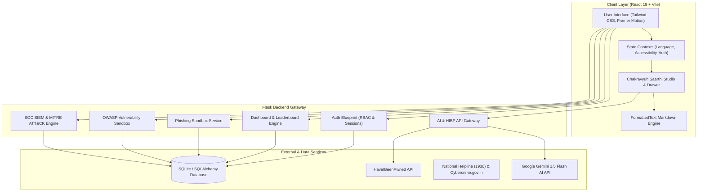
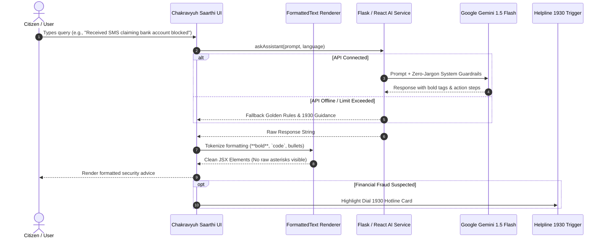
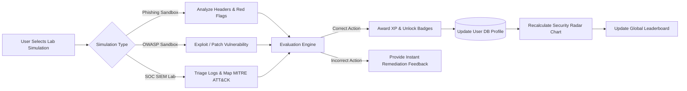
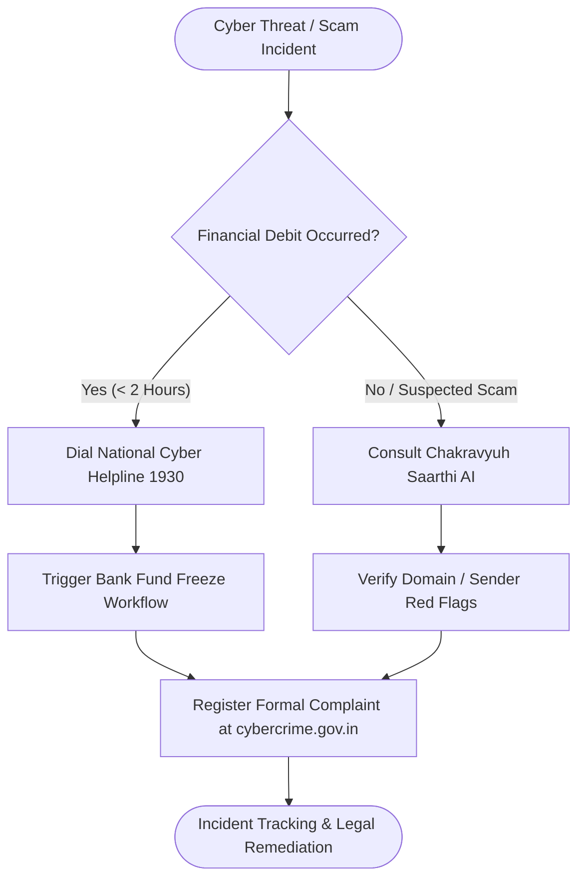

# 🛡️ Chakravyuh — Advanced Web Security Awareness Portal

> **Gamified, Scenario-Driven Multilingual Cybersecurity Defense & AI Awareness Platform**

[](https://react.dev/)
[](https://vitejs.dev/)
[](https://tailwindcss.com/)
[](https://flask.palletsprojects.com/)
[](https://python.org/)
[](https://ai.google.dev/)
[](https://www.sqlite.org/)

---

## 📋 Table of Contents
- [Overview](#-overview)
- [Key Features](#-key-features)
- [System Architecture](#-system-architecture)
- [Chakravyuh Saarthi AI Data Flow](#-chakravyuh-saarthi-ai-data-flow)
- [Threat Simulation & Gamification Pipeline](#-threat-simulation--gamification-pipeline)
- [National Incident Escalation Workflow](#-national-incident-escalation-workflow)
- [Tech Stack](#-tech-stack)
- [Installation & Setup](#-installation--setup)
- [Project Directory Structure](#-project-directory-structure)
- [API & Blueprint Documentation](#-api--blueprint-documentation)
- [Contributing & License](#-contributing--license)

---

## 🌟 Overview

**Chakravyuh** is an end-to-end cybersecurity awareness, threat intelligence, and defense training portal designed to empower citizens, students, and cybersecurity professionals. By combining **gamified interactive sandboxes**, **OWASP vulnerability labs**, **SOC SIEM log analysis**, and an **empathetic AI Security Mentor (Chakravyuh Saarthi)**, the portal translates complex security jargon into actionable defense habits.

The platform provides full **multilingual support (English, Hindi, and Hinglish)** and direct integration with India's **National Cyber Crime Helpline (1930)** and reporting portal (`cybercrime.gov.in`).

---

## ⚡ Key Features

### 🤖 1. Chakravyuh Saarthi (AI Security Companion)
- **Zero-Jargon Security Guidance**: Powered by Google Gemini 1.5 Flash to analyze suspicious SMS, emails, passphrases, and scam scenarios.
- **Multilingual Intelligence**: Speaks English, Hindi, and Hinglish natively.
- **Clean Markdown Formatting**: Custom regex engine (`FormattedText`) renders bold terms, inline code, and bullet lists cleanly without raw text syntax clutter (`**`).
- **Emergency Escalation**: Direct one-click dialer for **1930** during active financial fraud attempts.

### 🎣 2. Interactive Phishing & Spoofing Sandbox
- Simulated email inbox with fake headers, domain spoofing indicators, and malicious attachment inspection.
- Real-time feedback explaining why an email is legitimate vs. phishing.

### 🧪 3. OWASP Hands-on Vulnerability Labs
- Sandbox environments for learning and mitigating **SQL Injection (SQLi)**, **Cross-Site Scripting (XSS)**, and **Insecure Direct Object References (IDOR)**.

### 🔍 4. SOC Analyst SIEM Log Triage & MITRE ATT&CK Engine
- Interactive log analyzer for SOC beginners to inspect raw server access logs, detect brute-force or injection signatures, and map tactics to the **MITRE ATT&CK Framework**.

### 🇮🇳 5. Passive Resource & Legal Awareness Hub
- Comprehensive guide to national cyber laws (**IT Act 2000**), golden-hour reporting procedures, threat feeds, and downloadable safety checklists.

### 🏆 6. Gamified Skill Radar & Leaderboard
- XP scoring engine, streak tracking, level-up milestones, and dynamic radar charts quantifying user proficiency across 5 security domains.

---

## 📐 System Architecture

The following diagram illustrates the high-level architecture connecting the React frontend, Flask backend API, SQLite database, and external security services:



---

## 🔄 Chakravyuh Saarthi AI Data Flow

This sequence diagram depicts how user queries are processed through the AI security companion, transformed into empathetic advice, and rendered visually without raw markdown syntax:



---

## 🎮 Threat Simulation & Gamification Pipeline

How user actions inside the interactive sandboxes trigger scoring, badge awards, and leaderboard updates:



---

## 🚨 National Incident Escalation Workflow

The recommended workflow for citizens facing active cyber threats or financial fraud:



---

## 🛠️ Tech Stack

### Frontend
- **Framework**: React 19 + Vite 8
- **Styling**: Tailwind CSS v3, Vanilla CSS Design System, Custom Glassmorphism Utility
- **Icons & Animations**: Lucide React, Framer Motion, Canvas Confetti
- **Charts & Data Viz**: Recharts

### Backend
- **Framework**: Python 3.10+, Flask 3.0
- **Database / ORM**: SQLite, Flask-SQLAlchemy, Flask-Migrate
- **Authentication**: Flask-Login, Passlib / Werkzeug Security
- **AI Integration**: Google Generative AI (`google-generativeai` SDK)

---

## 🚀 Installation & Setup

### Prerequisites
- **Node.js**: v18.0.0 or higher
- **Python**: v3.10 or higher
- **Git**: Installed on your system

---

### 1. Backend Setup

```bash
# Clone the repository
git clone https://github.com/MazedOut/web-security-awareness-portal.git
cd web-security-awareness-portal

# Create a virtual environment
python -m venv venv

# Activate virtual environment
# On Windows (PowerShell):
.\venv\Scripts\Activate.ps1
# On Linux/macOS:
source venv/bin/activate

# Install dependencies
pip install -r requirements.txt

# Configure Environment Variables
cp .env.example .env
# Edit .env and supply your GEMINI_API_KEY if available

# Initialize database and run migrations
flask --app run.py db upgrade

# Seed initial threat scenarios & questions
python seed.py

# Start the Flask Backend Server
python run.py
```
> The Flask server runs at `http://127.0.0.1:5000`

---

### 2. Frontend Setup

Open a new terminal window in the project root:

```bash
# Navigate to the frontend directory
cd frontend

# Install Node dependencies
npm install

# Start the Vite development server
npm run dev
```
> The React frontend app runs at `http://localhost:5173`

---

## 📁 Project Directory Structure

```
web-security-awareness-portal/
├── README.md                  # Project documentation (You are here)
├── task.md                    # Implementation roadmap
├── config.py                  # Flask configuration & environment settings
├── run.py                     # Entry point for Flask server
├── seed.py                    # Database seeding script
├── requirements.txt           # Python dependencies
├── app/                       # Flask Backend Application Package
│   ├── __init__.py            # App factory
│   ├── models/                # SQLAlchemy database models
│   ├── services/              # Gemini AI & HIBP external services
│   └── blueprints/            # Modular Blueprint architecture
│       ├── admin/             # CMS & cohort analytics
│       ├── api/               # AI Assistant & JSON endpoints
│       ├── auth/              # Registration, login & session management
│       ├── dashboard/         # Leaderboard, stats & user profile
│       ├── owasp_labs/        # SQLi, XSS & IDOR sandboxes
│       ├── passive_hub/       # Cyber laws, helplines & feeds
│       ├── phishing/          # Email phishing simulator
│       └── soc_analyst/       # SIEM log analyzer & MITRE ATT&CK
└── frontend/                  # React + Vite Frontend Workspace
    ├── index.html
    ├── package.json
    ├── vite.config.js
    └── src/
        ├── App.jsx            # Routing & main layout wrapper
        ├── main.jsx           # React DOM entry point
        ├── api/               # Axios API client setup
        ├── components/        # Modular UI components
        │   ├── ai/            # Chakravyuh Saarthi Drawer & Floating widget
        │   ├── awareness/     # Threat cards & guides
        │   ├── common/        # GlassCard, Badge, FormattedText
        │   ├── layout/        # Navbar, Footer, Background Effects
        │   ├── network/       # Threat network visualization
        │   └── simulations/   # Sandbox interactive tools
        ├── context/           # Language, Auth, & Accessibility providers
        ├── pages/             # Main application route views
        └── services/          # Frontend AI & simulation services
```

---

## 🔌 API & Blueprint Documentation

| Blueprint | Route Prefix | Key Responsibilities |
| :--- | :--- | :--- |
| **Auth** | `/auth` | User registration, login, logout, session management, RBAC |
| **Dashboard** | `/dashboard` | XP tracking, badges, leaderboard ranking, radar chart data |
| **Phishing** | `/phishing` | Interactive phishing email inbox & header analysis lab |
| **OWASP Labs** | `/owasp` | Interactive sandboxes for SQLi, XSS, and IDOR vulnerabilities |
| **SOC Analyst** | `/soc` | SIEM log analyzer, incident response game, MITRE ATT&CK matrix |
| **Passive Hub** | `/hub` | Indian cyber laws (IT Act), Helpline 1930 details, reporting guides |
| **API** | `/api` | Gemini AI Security Mentor gateway, HIBP password check, progress tracking |
| **Admin** | `/admin` | CMS management for phishing templates, scenarios, cohort analytics |

---

## 🤝 Contributing & License

Contributions are welcome! If you would like to add new threat simulation scenarios, extend the OWASP lab challenges, or improve localized Hindi/Hinglish translations:

1. Fork the project repository.
2. Create your feature branch (`git checkout -b feature/AmazingSecurityFeature`).
3. Commit your changes (`git commit -m 'Add new phishing scenario'`).
4. Push to the branch (`git push origin feature/AmazingSecurityFeature`).
5. Open a Pull Request.

Distributed under the **MIT License**. See `LICENSE` for more information.

---

<p center>
  Made with ❤️ for a Cyber-Safe Digital Bharat 🇮🇳
</p>
