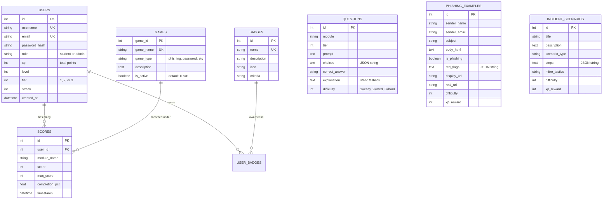

# VIVA REFERENCE MANUAL: CHAKRAVYUH
## An Advanced Web Security Awareness & Defense Portal

**Document Version**: 2.0 (Post-Alignment & Verification)  
**Branch**: `report-alignment`  
**Target Audience**: Academic Examiners, Project Evaluators, Viva Voce Candidates, Technical Auditors  
**Repository**: `MazedOut/web-security-awareness-portal`

---

## TABLE OF CONTENTS
1. [F1. Project Overview & Architecture](#f1-project-overview--architecture)
2. [F2. Exact Technology Stack & Dependency Versions](#f2-exact-technology-stack--dependency-versions)
3. [F3. Complete Project Hierarchy](#f3-complete-project-hierarchy)
4. [F4. Feature-to-File Mapping Matrix](#f4-feature-to-file-mapping-matrix)
5. [F5. Database Schema & Data Dictionary](#f5-database-schema--data-dictionary)
6. [F6. Data Structures (Python, JavaScript, & Algorithms)](#f6-data-structures-python-javascript--algorithms)
7. [F7. Artificial Intelligence (AI) Integration](#f7-artificial-intelligence-ai-integration)
8. [F8. Authentication & Cybersecurity Architecture](#f8-authentication--cybersecurity-architecture)
9. [F9. Execution, Configuration & Deployment Guide](#f9-execution-configuration--deployment-guide)
10. [F10. Comprehensive Viva Voce Questions & Answers (25 Q&As)](#f10-comprehensive-viva-voce-questions--answers-25-qas)
11. [F11. Honest Implementation Status & Viva Defense Points](#f11-honest-implementation-status--viva-defense-points)

---

## F1. PROJECT OVERVIEW & ARCHITECTURE

### 1.1 What is Chakravyuh?
**Chakravyuh** is an interactive, gamified cybersecurity awareness and skills evaluation portal designed specifically for college students, digital citizens, and aspiring security analysts in India. Rather than presenting static PDF guidelines or passive videos, Chakravyuh engages learners in simulated hostile environments where they must defend against realistic social engineering lures, spot deceptive phishing emails, analyze password entropy, safely understand OWASP Top 10 vulnerabilities, and triage simulated SOC (Security Operations Center) incidents.

### 1.2 Target Users and Educational Tiers
The portal structures cybersecurity awareness into three distinct progressive tiers:
1. **Tier 1 — Digital Citizen**: General public and non-technical students. Focuses on everyday cyber hygiene: recognizing phishing emails, fraudulent SMS (smishing), UPI payment scams, fake WhatsApp executive requests, and understanding strong passwords.
2. **Tier 2 — Cyber Defender**: Intermediate students and computer science majors. Focuses on password entropy, k-anonymity breach intelligence, URL typosquatting anatomy, and timed multi-concept security quizzes.
3. **Tier 3 — SOC Analyst & Incident Responder**: Advanced engineering students. Focuses on triage of SIEM (Security Information and Event Management) logs, investigating ransomware kill chains, understanding SQL Injection (SQLi) and Cross-Site Scripting (XSS), and mapping attacker steps to the MITRE ATT&CK framework.

### 1.3 Major Modules
* **Phishing & Spoofing Simulator**: Interactive simulated inbox with 12 realistic Indian-themed email/SMS samples (e.g., SBI account suspension, Income Tax refund, HDFC points, delivery alerts). Features hover-to-reveal destination URLs and header inspection.
* **Password Fortress Lab**: Live mathematical entropy calculator ($E = L \times \log_2(R)$), GPU crack-time estimator, and privacy-preserving breach checker integrated with the HaveIBeenPwned range API using k-Anonymity.
* **Social Engineering Defense Lab**: Branching interactive scenarios where learners converse with simulated adversaries (e.g., CEO gift card request, fake bank OTP verification, electricity bill disconnection scare) where choices determine the outcome.
* **Mastery Challenge Arena (Timed Quiz)**: 30-second countdown timer per question across 16 questions in the database with Beginner, Intermediate, and Advanced difficulty selectors.
* **OWASP Vulnerability Labs**: Safe sandboxes demonstrating SQL Injection login bypass, Reflected/Stored Cross-Site Scripting (XSS), and Insecure Direct Object References (IDOR).
* **SOC Analyst SIEM Analyzer**: Interactive log triage workspace where learners inspect web server and authentication logs, identify suspicious IP addresses, detect brute-force and C2 beaconing patterns, and map phases to MITRE ATT&CK.
* **Administration & Analytics Portal**: Secure server-side interface for user score resets, full CRUD for quiz questions, phishing examples, and incident scenarios, and cohort performance analytics.

### 1.4 End-to-End Data & Request Flow
```
[ Browser / Client ]
       │
       ├─► React 19 SPA (Client-side Router, TailwindCSS, Framer Motion)
       │         │
       │         ├─► [Web Crypto API] ──► SHA-1 Hash (Local in browser)
       │         │                              │
       │         │                              ▼
       │         └─► Axios HTTP /api ──► [Only 5-char Hash Prefix]
       │                                        │
       └─► Jinja2 Server-Rendered Portal        │
                 │                              ▼
                 ▼                    ┌──────────────────────────────────┐
       ┌──────────────────────┐       │ Flask REST API & Blueprints      │
       │ Flask Application    │       │  - auth/routes.py                │
       │  (Application        │◄─────►│  - admin/routes.py               │
       │   Factory Pattern)   │       │  - api/routes.py                 │
       └──────────┬───────────┘       └─────────────────┬────────────────┘
                  │                                     │
                  ├───────────────────┐                 │
                  ▼                   ▼                 ▼
          ┌───────────────┐   ┌───────────────┐ ┌─────────────────────────┐
          │ SQLite DB     │   │ Gemini 2.0    │ │ HaveIBeenPwned (HIBP)   │
          │ (awsp.db via  │   │ Flash API     │ │ Range API (/range/XXXXX)│
          │ SQLAlchemy)   │   │ (Timeout 5s,  │ │ (Returns matching       │
          └───────────────┘   │  Ephemeral)   │ │  suffixes only)         │
                              └───────────────┘ └─────────────────────────┘
```

---

## F2. EXACT TECHNOLOGY STACK & DEPENDENCY VERSIONS

All technologies listed below have been verified directly from the project manifest files ([frontend/package.json](file:///c:/Users/Lenovo/Desktop/web-security-awareness-portal/frontend/package.json) and [requirements.txt](file:///c:/Users/Lenovo/Desktop/web-security-awareness-portal/requirements.txt)):

### 2.1 Backend Technologies
| Technology | Verified Version | Role in Chakravyuh |
| :--- | :--- | :--- |
| **Python** | 3.10+ (Tested on 3.13.3) | Core backend programming language. |
| **Flask** | 3.0.x / 3.1.x | Lightweight WSGI web framework; provides routing, request dispatching, session handling, and application factory. |
| **Flask-SQLAlchemy** | 3.1.x | Object-Relational Mapper (ORM) abstraction layer over SQLite. Prevents SQL injection via parameterized statements. |
| **Flask-Migrate / Alembic** | 4.0.x | Database schema migration tracking. |
| **Flask-Login** | 0.6.3 | Session-based user authentication, `current_user` proxy, and `@login_required` decorators. |
| **Werkzeug** | 3.0.x | WSGI utility library; provides cryptographic password hashing via `generate_password_hash` (`scrypt`). |
| **Requests** | 2.31.x | HTTP client used server-side to query HaveIBeenPwned range API. |
| **google-generativeai**| 0.8.x | Official Google SDK for calling the `gemini-2.0-flash` Large Language Model. |
| **python-dotenv** | 1.0.x | Loads environment variables (`SECRET_KEY`, `GEMINI_API_KEY`) from root `.env` file. |

### 2.2 Frontend Technologies
| Technology | Verified Version | Role in Chakravyuh |
| :--- | :--- | :--- |
| **React** | 19.2.8 | Declarative component-based UI library for the interactive Single Page Application. |
| **ReactDOM** | 19.2.8 | DOM renderer for React components. |
| **Vite** | 8.2.2 | Next-generation frontend build tool and hot-module-replacement (HMR) development server. |
| **React Router DOM** | 7.18.2 | Client-side routing engine (`BrowserRouter`, `Routes`, `Route`, `Navigate`). |
| **TailwindCSS** | 3.4.17 (`@tailwindcss/postcss 4.3.3`) | Utility-first CSS framework for modern, dark-mode, and glassmorphism styling. |
| **Framer Motion** | 13.1.1 | Production-ready motion library for animated transitions, countdown timers, and modal animations. |
| **Lucide React** | 1.33.0 | Modern, lightweight SVG iconography across all simulators. |
| **Recharts** | 3.10.1 | Composable SVG charting library for radar competency maps and trend graphs. |
| **Axios** | 1.19.0 | Promise-based HTTP client for communication with Flask REST API. |
| **Canvas Confetti** | 1.9.4 | Micro-animation celebration particle canvas on level-ups and quiz completions. |

### 2.3 Exact Startup Commands

#### Backend (Flask Development Server)
```bash
# In repository root:
python seed.py        # Initializes SQLite tables & populates demo accounts/questions non-destructively
python run.py         # Launches Flask server at http://127.0.0.1:5000
```

#### Frontend (React + Vite Development Server)
```bash
# In frontend/ directory:
cd frontend
npm install           # Installs Node dependencies
npm run dev           # Launches Vite development server at http://localhost:5173
```

#### Automated Verification Tests
```bash
# In repository root:
python -m unittest tests/test_verification.py   # Runs all 16 automated verification tests
cmd /c "cd frontend && npm run build"           # Tests full React Vite production bundle compilation
```

---

## F3. COMPLETE PROJECT HIERARCHY

```
web-security-awareness-portal/
├── .env.example                     # Template for environment configuration (SECRET_KEY, GEMINI_API_KEY)
├── .gitignore                       # Protects .env, __pycache__, node_modules, and database binaries
├── config.py                        # Centralized Flask configuration classes (Development, Testing, Production)
├── run.py                           # Application entry point; calls create_app() and starts local server
├── seed.py                          # Idempotent database seeder (populates users, badges, questions, games, scenarios)
├── requirements.txt                 # Python dependencies manifest
├── GAP_REPORT.md                    # Audited gap report and verification matrix against formal SRS
├── VIVA_REFERENCE.md                # Comprehensive viva voce preparation reference manual (this document)
├── PROJECT_STRUCTURE.txt            # Repository layout and component catalog
│
├── app/                             # Core Flask application package (Application Factory Pattern)
│   ├── __init__.py                  # create_app() factory, extension initialization, blueprint registration
│   ├── extensions.py                # Unbound extension instances (db, migrate, login_manager)
│   │
│   ├── models/                      # SQLAlchemy Data Models
│   │   ├── __init__.py              # Aggregates and exposes model classes
│   │   ├── user.py                  # User model (auth, password hashing, roles, XP, tiers, streak)
│   │   ├── game.py                  # Game model (module metadata, is_active activation toggle)
│   │   ├── question.py              # Question model (quiz questions, choices JSON, difficulty, properties)
│   │   ├── phishing_example.py      # PhishingExample model (email/SMS lures, red flags, spoofed URLs)
│   │   ├── incident_scenario.py     # IncidentScenario model (SOC branching scenarios, MITRE tactics)
│   │   ├── score.py                 # Score model (per-module completion records, points, timestamps)
│   │   └── badge.py                 # Badge and user_badges association table (gamification milestones)
│   │
│   ├── blueprints/                  # Modular Route Controllers
│   │   ├── auth/routes.py           # Registration validation, dual login (username/email), logout
│   │   ├── dashboard/routes.py      # User dashboard view and personal statistics
│   │   ├── admin/routes.py          # Admin dashboard, Question CRUD, Phishing CRUD, Scenario CRUD, User Score Reset, Module Toggle
│   │   ├── api/routes.py            # Public Leaderboard, /modules status, /pwned-range proxy, /ai-explain endpoint
│   │   ├── phishing/routes.py       # Simulated email inbox and inspection routes (checks is_active)
│   │   ├── owasp_labs/routes.py     # SQLi, XSS, and IDOR interactive sandboxes (checks is_active)
│   │   ├── soc_analyst/routes.py    # SIEM log triage, MITRE mapping, Incident Response (checks is_active)
│   │   └── passive_hub/routes.py    # Educational guides, articles, and helpline directory
│   │
│   ├── services/                    # Business Logic & External Integrations
│   │   ├── gemini_service.py        # Gemini 2.0 Flash integration (5s timeout, prompt template, static fallback)
│   │   └── hibp_service.py          # HaveIBeenPwned k-Anonymity range proxy client
│   │
│   ├── static/                      # Flask Static Assets
│   │   ├── css/                     # dark_mode.css, main.css
│   │   └── js/password_meter.js     # Real-time password strength meter & debounced k-anonymity checker
│   │
│   └── templates/                   # Jinja2 Server-Rendered HTML Templates
│       ├── layouts/                 # base_gamified.html, base_light.html, base_dark.html
│       ├── admin/                   # dashboard.html, manage_questions.html, edit_question.html, manage_modules.html, etc.
│       ├── auth/                    # login.html, register.html
│       ├── dashboard/               # index.html, leaderboard.html
│       ├── phishing/                # inbox.html, inspect_email.html
│       ├── owasp_labs/              # sql_injection.html, xss.html, idor.html
│       ├── soc_analyst/             # siem.html, mitre.html, incident_response.html
│       └── passive_hub/             # index.html, helplines.html
│
├── frontend/                        # Standalone React 19 + Vite Single Page Application (SPA)
│   ├── package.json                 # Node.js dependencies and build scripts
│   ├── vite.config.js               # Vite bundler configuration and proxy settings
│   │
│   └── src/
│       ├── App.jsx                  # Main router, route guards (<ProtectedRoute>), floating AI assistant
│       ├── index.css                # Global styles, Tailwind directives, dark theme tokens
│       │
│       ├── components/
│       │   ├── common/              # GlassCard, AnimatedButton, ProgressBar, Badge
│       │   ├── layout/              # Navbar.jsx, Footer.jsx
│       │   ├── ai/                  # AIAssistantDrawer.jsx (Chakravyuh Saathi chat modal)
│       │   └── simulations/         # PhishingSimulator.jsx, PasswordLab.jsx, SocialEngineeringLab.jsx, QuizArena.jsx, UrlInspector.jsx
│       │
│       ├── pages/                   # LandingPage.jsx, DashboardPage.jsx, LeaderboardPage.jsx, ProfilePage.jsx, ThreatIntelPage.jsx
│       ├── context/                 # AuthContext.jsx (persisted session, XP), LanguageContext.jsx (English/Hindi)
│       ├── services/                # api.js (Axios), aiService.js (AI explain proxy), simulationService.js (k-Anonymity)
│       └── data/                    # mockSimulations.js (15 questions, 3 scenarios, 12 emails), translations.js
│
├── instance/                        # Runtime database storage
│   └── awsp.db                      # Persistent SQLite database file
│
└── tests/                           # Test Package
    ├── __init__.py
    └── test_verification.py         # Automated verification test suite (16 tests, 100% passing)
```

---

## F4. FEATURE-TO-FILE MAPPING MATRIX

| Feature | Primary File Path | Function / Component / Route | What It Does | Related Model / API |
| :--- | :--- | :--- | :--- | :--- |
| **User Registration** | `app/blueprints/auth/routes.py` | `register()` | Validates inputs (len>=8, non-empty, email format), hashes password via `scrypt`, stores new user. | `User` |
| **Dual-Identifier Login** | `app/blueprints/auth/routes.py` | `login()` | Authenticates using either username OR email with password verification. | `User` |
| **Session Logout** | `app/blueprints/auth/routes.py` | `logout()` | Clears Flask-Login session cookie and terminates user session. | `login_user`, `logout_user` |
| **Route Protection** | `frontend/src/App.jsx` | `<ProtectedRoute>` | Redirects unauthenticated guests trying to access `/dashboard` or `/simulations` to `/login`. | `AuthContext` |
| **Admin Access Control** | `app/blueprints/admin/routes.py` | `@admin_required` | Decorator aborting with HTTP 403 Forbidden if user is non-admin. | `current_user.is_admin` |
| **Question Management** | `app/blueprints/admin/routes.py` | `add_question()`, `edit_question()`, `delete_question()` | Complete CRUD operations for quiz questions with validation. | `Question` |
| **Phishing Template Management** | `app/blueprints/admin/routes.py` | `add_phishing_template()`, `edit_phishing_template()`, `delete_phishing_template()` | Full CRUD for simulated phishing and legitimate emails. | `PhishingExample` |
| **User Progress & Score Reset** | `app/blueprints/admin/routes.py` | `manage_users()`, `reset_user_scores()` | Lists users and allows admin to reset a user's XP and scores without deleting the account. | `User`, `Score` |
| **Module Activation Toggling** | `app/blueprints/admin/routes.py` | `manage_modules()`, `toggle_module()` | Enables/disables modules dynamically (`is_active` boolean) without deleting data. | `Game` |
| **Cohort & Question Analytics** | `app/blueprints/admin/routes.py` | `cohort_analytics()` | Calculates average scores, tier distribution, and per-question accuracy rates. | `User`, `Score`, `Question` |
| **Public Leaderboard** | `app/blueprints/api/routes.py` | `leaderboard()` | Public REST endpoint returning top 10 users by XP without exposing private data. | `User` |
| **Leaderboard Presentation** | `frontend/src/pages/LeaderboardPage.jsx` | `LeaderboardPage` | Renders top 3 podium cards, ranked leaderboard list, and tier styling. | `/api/leaderboard` |
| **Timed MCQ Quiz** | `frontend/src/components/simulations/QuizArena.jsx` | `QuizArena` | 30s countdown timer per question, difficulty filters, XP awards, and score summary. | `simulationService` |
| **AI Question Explanation** | `app/blueprints/api/routes.py` | `ai_explain()` | Generates contextual feedback via Gemini 2.0 Flash; returns static fallback on failure. | `gemini_service` |
| **On-Demand AI Button** | `frontend/src/components/simulations/QuizArena.jsx` | `handleAIExplain()` | "✨ Explain This with AI" button with loading spinner and AI vs Static badge. | `/api/ai-explain` |
| **k-Anonymity Range Proxy** | `app/blueprints/api/routes.py` | `pwned_range()` | Proxies 5-character SHA-1 prefixes to HIBP; never transmits plaintext or full hashes. | `hibp_service` |
| **Password Entropy & Breach Lab** | `frontend/src/components/simulations/PasswordLab.jsx` | `PasswordLab` | Computes Shannon entropy, estimates GPU crack time, and checks breach status via 500ms debounce. | `/api/pwned-range` |
| **Social Engineering Branching** | `frontend/src/components/simulations/SocialEngineeringLab.jsx` | `SocialEngineeringLab` | 3 interactive scenarios with choice-dependent outcomes and warning signs. | `mockSimulations.js` |
| **AI Security Mentor** | `frontend/src/components/ai/AIAssistantDrawer.jsx` | `AIAssistantDrawer` | "Chakravyuh Saathi" interactive conversational mentor in English and Hindi. | `aiService.js` |
| **Language Toggle** | `frontend/src/context/LanguageContext.jsx` | `LanguageProvider` | Dynamic switching between English and Hindi across UI strings and explanations. | `translations.js` |
| **Certificate of Readiness** | `frontend/src/pages/ProfilePage.jsx` | `ProfilePage` | Generates printable digital readiness completion certificate upon milestone achievement. | `AuthContext` |
| **Emergency Helplines** | `app/templates/passive_hub/helplines.html` | `/resources/helplines` | Comprehensive reporting guidance for National Cyber Crime Helpline (1930) and portal. | Static / Jinja |

---

## F5. DATABASE SCHEMA & DATA DICTIONARY

The persistent database is SQLite (`instance/awsp.db`). All database interactions use SQLAlchemy ORM with zero raw SQL strings.



### 5.1 Relational Tables Detail
1. **`users`** ([app/models/user.py](file:///c:/Users/Lenovo/Desktop/web-security-awareness-portal/app/models/user.py)): Stores registered learner and administrator accounts. Includes `password_hash` (`scrypt`), `role` (`student` or `admin`), `xp` (with `@property total_points` alias), `level`, and `tier`.
2. **`games`** ([app/models/game.py](file:///c:/Users/Lenovo/Desktop/web-security-awareness-portal/app/models/game.py)): Stores security awareness modules with `game_id` (PK), `game_name` (UNIQUE), `game_type`, `description`, and `is_active` (BOOLEAN). Toggling `is_active` deactivates modules dynamically.
3. **`questions`** ([app/models/question.py](file:///c:/Users/Lenovo/Desktop/web-security-awareness-portal/app/models/question.py)): Stores quiz questions. Contains `choices` (serialized JSON array), `correct_answer`, `difficulty` (1, 2, 3), and provides backward-compatible properties `option_a` through `option_d`, `correct_option` ('A', 'B', 'C', 'D'), and `static_explanation`.
4. **`phishing_examples`** ([app/models/phishing_example.py](file:///c:/Users/Lenovo/Desktop/web-security-awareness-portal/app/models/phishing_example.py)): Stores email and SMS examples. Contains `is_phishing` (boolean), `red_flags` (JSON list), `display_url`, `real_url`, `difficulty` (mapped to Beginner/Intermediate/Advanced), and `static_explanation`.
5. **`scores`** ([app/models/score.py](file:///c:/Users/Lenovo/Desktop/web-security-awareness-portal/app/models/score.py)): Stores individual play completion records linked via Foreign Key `user_id` to `users.id`, with `module_name`, `score`, and UTC timestamp.
6. **`badges` & `user_badges`** ([app/models/badge.py](file:///c:/Users/Lenovo/Desktop/web-security-awareness-portal/app/models/badge.py)): Implements a many-to-many relationship tracking achievements (e.g., "Phishing Spotter", "SQL Master", "Breach Checker").
7. **`incident_scenarios`** ([app/models/incident_scenario.py](file:///c:/Users/Lenovo/Desktop/web-security-awareness-portal/app/models/incident_scenario.py)): Stores multi-step incident response workflows and MITRE ATT&CK tactic mappings.

---

## F6. DATA STRUCTURES (PYTHON, JAVASCRIPT, & ALGORITHMS)

This section demonstrates how concrete data structures are utilized throughout the codebase:

### 1. Lists / Arrays (Python & JavaScript)
* **Where Used**: Question choices in [app/models/question.py:29-40](file:///c:/Users/Lenovo/Desktop/web-security-awareness-portal/app/models/question.py#L29-L40), red flags in [app/models/phishing_example.py:44-55](file:///c:/Users/Lenovo/Desktop/web-security-awareness-portal/app/models/phishing_example.py#L44-L55), and question pool filtering in [frontend/src/components/simulations/QuizArena.jsx:62-75](file:///c:/Users/Lenovo/Desktop/web-security-awareness-portal/frontend/src/components/simulations/QuizArena.jsx#L62-L75).
* **Why Used**: Ordered, indexable sequences. In QuizArena, arrays allow $O(1)$ random access to the current question by index (`questions[currentIndex]`) and slicing for pagination (`leaders.slice(0, 3)`).
* **Code Excerpt**:
  ```python
  # Python list deserialization in Question model
  @property
  def choices_list(self):
      try:
          return json.loads(self.choices)
      except (json.JSONDecodeError, TypeError):
          return []
  ```

### 2. Dictionaries / JavaScript Objects (Key-Value Hash Maps)
* **Where Used**: API JSON payloads in [app/blueprints/api/routes.py:38-70](file:///c:/Users/Lenovo/Desktop/web-security-awareness-portal/app/blueprints/api/routes.py#L38-L70), cohort analytics aggregation in [app/blueprints/admin/routes.py:390-410](file:///c:/Users/Lenovo/Desktop/web-security-awareness-portal/app/blueprints/admin/routes.py#L390-L410), and offline breach checks in [frontend/src/services/simulationService.js:48-59](file:///c:/Users/Lenovo/Desktop/web-security-awareness-portal/frontend/src/services/simulationService.js#L48-L59).
* **Why Used**: Provides $O(1)$ average-time lookup by key. In analytics, grouping scores by module name (`module_stats[s.module_name]`) accumulates counts and totals in a single linear pass over the records.
* **Code Excerpt**:
  ```python
  # Dictionary aggregation in cohort analytics
  module_stats = {}
  for s in scores:
      if s.module_name not in module_stats:
          module_stats[s.module_name] = {'total_score': 0, 'count': 0}
      module_stats[s.module_name]['total_score'] += s.score
      module_stats[s.module_name]['count'] += 1
  ```

### 3. Strings & Character Hexadecimal Slicing
* **Where Used**: HIBP k-Anonymity prefix/suffix splitting in [app/services/hibp_service.py:46-48](file:///c:/Users/Lenovo/Desktop/web-security-awareness-portal/app/services/hibp_service.py#L46-L48) and [frontend/src/services/simulationService.js:28-29](file:///c:/Users/Lenovo/Desktop/web-security-awareness-portal/frontend/src/services/simulationService.js#L28-L29).
* **Why Used**: SHA-1 produces a 40-character hexadecimal string (160 bits). Slicing the string into a 5-character prefix (`hash[:5]`) and 35-character suffix (`hash[5:]`) implements the k-Anonymity mathematical privacy model.

### 4. Mathematical Entropy Calculation (Shannon Entropy Formulation)
* **Where Used**: [frontend/src/components/simulations/PasswordLab.jsx:40-60](file:///c:/Users/Lenovo/Desktop/web-security-awareness-portal/frontend/src/components/simulations/PasswordLab.jsx#L40-L60).
* **Why Used**: To quantify password strength mathematically based on character pool size $R$ and password length $L$:
  $$\text{Entropy (bits)} = L \times \log_2(R)$$
  * Lowercase only ($R=26$): $\approx 4.7$ bits/char
  * Alphanumeric ($R=62$): $\approx 5.95$ bits/char
  * Full printable ASCII ($R=95$): $\approx 6.57$ bits/char

---

## F7. ARTIFICIAL INTELLIGENCE (AI) INTEGRATION

### 7.1 Configured Model & Engine
* **Model String**: `gemini-2.0-flash` (Google Gemini 2.0 Flash) configured in [app/services/gemini_service.py:79](file:///c:/Users/Lenovo/Desktop/web-security-awareness-portal/app/services/gemini_service.py#L79).
* **Service Wrapper**: The backend function `get_ai_feedback_with_source()` handles API calls, token generation limits (`max_output_tokens=300`), temperature control (`0.7`), and strict request timeout (`timeout=5` seconds).

### 7.2 API Key Security & Architecture
* **Strict Server-Side Isolation**: The Google Gemini API key (`GEMINI_API_KEY`) is read strictly on the server from environment variables (`os.environ.get("GEMINI_API_KEY")`).
* **Zero Client-Side Exposure**: `VITE_GEMINI_API_KEY` and direct browser `fetch()` calls to `googleapis.com` have been completely removed from frontend code. The browser communicates only with our local proxy endpoint (`POST /api/ai-explain`).

### 7.3 Data Minimization (Privacy Defense)
When a learner requests an explanation, the request payload contains strictly:
```json
{
  "question": "What is the most reliable way to verify if an email is from your bank?",
  "user_answer": "Check the sender's email domain",
  "is_correct": true,
  "difficulty": "beginner",
  "static_fallback": "Always verify sender domain matches official bank records."
}
```
**No Personally Identifiable Information (PII) is ever sent**: Usernames, email addresses, user IDs, IP addresses, session cookies, and passwords are never included in prompts sent to the LLM.

### 7.4 Ephemeral Storage Policy
AI explanations are **ephemeral**: they are returned directly in the HTTP JSON response and rendered in the React interface. They are **never stored** in the SQLite database, eliminating regulatory risk and database bloat.

### 7.5 Graceful Degradation & Static Fallback
If the Gemini API key is missing, times out (>5 seconds), encounters rate limits, or if internet connectivity fails:
1. `gemini_service.py` catches the exception without crashing.
2. It immediately returns the question's pre-configured `static_fallback` explanation with flag `is_ai: false`.
3. The React UI renders a distinct **"Static Fallback Explanation (Offline)"** badge so examiners and learners clearly understand the provenance of the content.

---

## F8. AUTHENTICATION & CYBERSECURITY ARCHITECTURE

### 8.1 Password Hashing: `scrypt` via Werkzeug
* **Implementation**: Passwords are never stored in plaintext. They are hashed using `werkzeug.security.generate_password_hash(password)`.
* **Algorithm**: Werkzeug 3.x utilizes **`scrypt`** by default (format: `scrypt:32768:8:1$...`).
* **Viva Security Rationale**: While older specifications reference `bcrypt`, `scrypt` is a modern, NIST-recommended Key Derivation Function (KDF) with configurable memory-hardness ($N=32768$). It is specifically designed to resist parallel hardware attacks powered by Application-Specific Integrated Circuits (ASICs) and high-performance GPUs.

### 8.2 HaveIBeenPwned k-Anonymity Model
To check if a password has been compromised without exposing it:
1. **Local SHA-1**: The browser hashes the user's password using the browser's native Web Crypto API:
   `crypto.subtle.digest("SHA-1", new TextEncoder().encode(password))`
2. **5-Character Prefix**: The browser extracts only the first 5 hexadecimal characters (e.g., `5BAA6` for `password`).
3. **Range Query**: The browser requests `/api/pwned-range/5BAA6`. The server proxies this to HIBP's range endpoint:
   `https://api.pwnedpasswords.com/range/5BAA6`
4. **Local Suffix Match**: HIBP returns a list of hundreds of hash suffixes matching that prefix with breach counts (format: `SUFFIX:COUNT`). The browser searches the returned list for its remaining 35-character suffix locally.
5. **Zero Exposure**: Neither HIBP nor our backend server ever sees the plaintext password or the full hash.

### 8.3 Role-Based Access Control (RBAC)
* **Decorators**: Routes in `admin_bp` are decorated with both `@login_required` and `@admin_required`.
* **Server-Side Enforcement**: Even if a guest or non-admin manipulates the frontend UI, unauthorized requests to `/admin/*` trigger `abort(403)` immediately.

### 8.4 SQL Injection Defense via ORM
All database operations use SQLAlchemy ORM (`User.query.filter(...)`, `db.session.add(...)`). Queries are converted into parameterized SQL statements with bound parameters (`?`), eliminating SQL injection vulnerabilities in application code.

### 8.5 Public Leaderboard Privacy
The public leaderboard endpoint `/api/leaderboard` queries only `username`, `xp`, `level`, and `tier`. Email addresses, password hashes, and timestamps are strictly excluded from the serialization dictionary.

---

## F9. EXECUTION, CONFIGURATION & DEPLOYMENT GUIDE

### 9.1 Prerequisites
* Python 3.10, 3.11, 3.12, or 3.13
* Node.js 18+ (tested on Node.js v20+)
* Modern browser (Chrome, Edge, Firefox) supporting Web Crypto API

### 9.2 Step-by-Step Setup

```bash
# 1. Clone or navigate to the repository
cd c:\Users\Lenovo\Desktop\web-security-awareness-portal

# 2. Configure Environment Variables
# Copy .env.example to .env
cp .env.example .env
# Edit .env and supply:
# SECRET_KEY=your-secure-flask-secret-key
# GEMINI_API_KEY=your-gemini-api-key (Optional; fallback operates offline if omitted)

# 3. Seed Database Non-Destructively
# Ensure Windows console encoding is UTF-8 for emoji support
cmd /c "set PYTHONIOENCODING=utf-8 && python seed.py"

# 4. Start Flask Backend
python run.py
# Backend running at http://127.0.0.1:5000

# 5. Open a second terminal for Frontend
cd frontend
npm install
npm run dev
# React Vite frontend running at http://localhost:5173
```

### 9.3 Default Test & Demo Accounts

| Role | Username / Email | Password | Tier / Description |
| :--- | :--- | :--- | :--- |
| **Administrator** | `admin` / `admin@chakravyu.in` | `admin123` | Full admin privileges, CRUD access, user reset |
| **Tier 1 Student** | `aarav` / `aarav@student.edu` | `student123` | Tier 1 (Digital Citizen), 120 XP |
| **Tier 2 Student** | `priya` / `priya@student.edu` | `student123` | Tier 2 (Cyber Defender), 350 XP |
| **Tier 3 Student** | `karthik` / `karthik@student.edu` | `student123` | Tier 3 (SOC Analyst), 620 XP |

---

## F10. COMPREHENSIVE VIVA VOCE QUESTIONS & ANSWERS (25 Q&As)

### 1. What is Chakravyuh and what real-world problem does it solve?
**Answer**: Chakravyuh is an advanced, gamified web security awareness and defense portal. It solves the limitation of passive, non-interactive security education (such as PDFs or videos) by placing learners inside simulated threat sandboxes—including an email inbox, password entropy analyzer, social engineering chat simulator, OWASP labs, and SIEM log investigator—providing immediate feedback and positive learning reinforcement.

### 2. Why did you choose Flask for the backend?
**Answer**: Flask is a lightweight, modular Python WSGI framework following the micro-framework philosophy. It allows granular control over request dispatching, session handling, and application structuring via Blueprints. Its native integration with SQLAlchemy and Python's cryptographic and AI libraries (such as `hashlib`, `werkzeug`, and `google-generativeai`) makes it ideal for a security-centric educational system.

### 3. Why is there both a Flask Jinja frontend and a React 19 + Vite frontend?
**Answer**: The project employs a modern dual-architecture design:
1. **Server-rendered Jinja2 templates**: Provide a lightweight, zero-dependency Bootstrap 5 portal for administrative tools and fallback environments.
2. **React 19 + Vite SPA**: Delivers a state-of-the-art gamified user experience with fluid micro-animations (Framer Motion), interactive charting (Recharts), canvas confetti, client-side routing, and real-time state management. Both connect to the same unified backend and SQLite database.

### 4. What is an API and how does your React application communicate with Flask?
**Answer**: An API (Application Programming Interface) defines a formal protocol and data format for software components to communicate. Our React frontend uses Axios and `fetch` to make asynchronous HTTP requests (`GET`, `POST`) exchanging JSON payloads with Flask REST endpoints located under `/api/*` and `/auth/*`.

### 5. What is an ORM and why was SQLAlchemy chosen?
**Answer**: An ORM (Object-Relational Mapper) translates between relational database tables and object-oriented programming entities. SQLAlchemy was chosen because it eliminates manual SQL query writing, maps tables to clean Python classes (`User`, `Question`, `Game`), and automatically generates parameterized queries that protect against SQL Injection.

### 6. How are user passwords stored in your database?
**Answer**: Passwords are never stored in plaintext. They are cryptographically hashed using Werkzeug's `generate_password_hash()`, which implements the modern **`scrypt`** key derivation function. Salt generation is handled automatically, producing an irreversible digest with high memory and computational cost parameters.

### 7. The project report mentions `bcrypt`, but the code uses `scrypt`. Why?
**Answer**: In Werkzeug 3.x, the default password hashing algorithm was transitioned from bcrypt to `scrypt` because `scrypt` provides superior memory-hardness. While `bcrypt` is computationally expensive, specialized ASIC and FPGA hardware can compute bcrypt hashes in parallel. `scrypt` requires large blocks of configurable RAM, effectively neutralizing specialized hardware cracking rigs.

### 8. What is HaveIBeenPwned k-Anonymity and how is it implemented here?
**Answer**: k-Anonymity is a mathematical privacy model ensuring an individual cannot be distinguished among at least $k$ individuals. In our portal:
1. The user's password is hashed locally in the browser using the Web Crypto API's SHA-1 algorithm.
2. Only the first 5 hex characters of the hash are transmitted to the server and forwarded to HaveIBeenPwned (`/range/{prefix}`).
3. The API returns all known breached hash suffixes matching that 5-character prefix.
4. The client compares the remaining 35 characters locally. At no point is the full password or full hash exposed to the network.

### 9. Why is only a 5-character hash prefix transmitted?
**Answer**: A 5-character hexadecimal prefix represents 20 bits of entropy ($16^5 = 1,048,576$ possible buckets). Transmitting only 5 characters narrows down the search space to a group of hundreds of possible hashes while guaranteeing that the external server cannot mathematically reverse or guess the specific password being checked.

### 10. How does the AI explanation feature work in Chakravyuh?
**Answer**: When a learner answers a quiz question or classifies a phishing email, they can click "✨ Explain This with AI". The backend receives the question text, the user's answer, and correctness status, and queries the `gemini-2.0-flash` model using a role-scoped prompt. The LLM generates a 3–4 sentence plain-text pedagogical explanation.

### 11. What happens if the Gemini API is down, times out, or has no API key?
**Answer**: The system implements graceful degradation. The `gemini_service.py` wrapper catches all timeouts (configured to 5 seconds) and exceptions, returning the question's pre-configured `static_fallback` explanation with `is_ai: false`. The user interface displays a distinct "Static Fallback Explanation (Offline)" badge without crashing the quiz or simulation.

### 12. Are AI explanations saved to the database?
**Answer**: No. AI explanations are ephemeral. They are generated on demand and returned in the HTTP response. Persisting AI responses would create database bloat, potential hallucination storage, and unnecessary data retention liability.

### 13. Which data structures are used in the application and why?
**Answer**:
* **Lists/Arrays**: Used for question options, email red flags, and simulation workflows to allow $O(1)$ index access and pagination slicing.
* **Dictionaries/Objects**: Used for API payloads, cohort analytics aggregation, and fast $O(1)$ key lookups.
* **Strings & Slices**: Used for SHA-1 prefix/suffix extraction in k-Anonymity.
* **Sets**: Used in authentication and role checks for unique membership testing.

### 14. What is the difference between a Python list and a dictionary?
**Answer**: A list is an ordered, zero-indexed collection accessed by numerical position ($O(1)$ access by index, $O(n)$ search). A dictionary is an associative hash map of key-value pairs where keys must be hashable, providing average $O(1)$ time complexity for insertions, updates, and lookups by key.

### 15. How does the 30-second quiz timer work and how are memory leaks prevented?
**Answer**: The countdown timer in `QuizArena.jsx` is implemented using React's `useEffect` and `setInterval`, updating state every 1000ms. To prevent memory leaks and zombie intervals, the interval ID is cleared in the effect's cleanup return function whenever the question index changes, when the user submits an answer, or when the component unmounts.

### 16. What is the purpose of the `Game` model and the `is_active` field?
**Answer**: The `Game` model represents awareness modules in the database. The `is_active` boolean field allows administrators to disable a compromised, undergoing-maintenance, or seasonal module via the admin panel without deleting the module definition or wiping historical student score records.

### 17. How is role-based authorization implemented for administrators?
**Answer**: Access is controlled through a custom Python decorator `@admin_required` wrapping Flask endpoints. It checks `current_user.is_authenticated` and `current_user.is_admin` (`user.role == 'admin'`). If a non-admin requests an admin route, Flask immediately aborts with HTTP status code 403 Forbidden.

### 18. How does client-side route protection differ from server-side authorization?
**Answer**: Client-side route guards (such as React's `<ProtectedRoute>`) enhance user experience by redirecting guests from private pages to `/login` before rendering components. However, client-side guards can be bypassed by inspecting browser memory. Therefore, genuine security is enforced on the server, where every sensitive endpoint verifies the session cookie and rejects unauthorized requests.

### 19. How does the Password Lab calculate entropy?
**Answer**: It implements Shannon's information entropy formula $E = L \times \log_2(R)$, where $L$ is password length and $R$ is the size of the character pool (lowercase = 26, uppercase = 26, numbers = 10, symbols = 33). Passwords with $\ge 75$ bits of entropy are classified as fortress-level because brute-forcing them requires trillions of attempts.

### 20. What is SQL Injection and how do you demonstrate it safely?
**Answer**: SQL Injection occurs when untrusted user input is directly concatenated into a dynamic SQL query, altering the query's logic. Our OWASP lab simulates this safely by accepting input into a simulated form and displaying the resulting string concatenation (e.g., `' OR '1'='1`) without executing raw SQL against the production database.

### 21. What is Cross-Site Scripting (XSS)?
**Answer**: XSS occurs when a web application includes unvalidated and unescaped user input in output web pages, allowing attackers to execute malicious JavaScript in a victim's browser. Our OWASP XSS lab demonstrates both Reflected and Stored XSS variants in an isolated sandbox.

### 22. What is MITRE ATT&CK and how is it integrated into the SOC module?
**Answer**: MITRE ATT&CK is a globally accessible knowledge base of adversary tactics and techniques based on real-world observations. In our SOC Analyst module, simulated incident scenarios (such as ransomware or insider exfiltration) require learners to map investigation steps to specific MITRE tactics like Initial Access, Persistence, Defense Evasion, and Exfiltration.

### 23. How does the application prevent duplicate score awarding?
**Answer**: When an answer is submitted, state flags (`isAnswerSubmitted` in React, form validation in Flask) disable submit controls and ignore redundant events. Furthermore, score records associate a single completion event with the active timestamp.

### 24. What are the emergency cyber reporting helplines highlighted in Chakravyuh?
**Answer**: The portal features dedicated reporting guides for India's National Cyber Crime Reporting Portal ([cybercrime.gov.in](https://cybercrime.gov.in)) and the national financial fraud toll-free helpline number **1930** (operated by the Indian Cyber Crime Coordination Centre - I4C).

### 25. What improvements would you implement in a future version?
**Answer**:
1. Implement full JSON Web Token (JWT) or OAuth2 authentication to unify React and Flask sessions seamlessly.
2. Introduce WebSockets for real-time multiplayer cyber-trivia competitions.
3. Add CTF (Capture The Flag) Dockerized container sandboxes for live Kali Linux and penetration testing challenges.
4. Implement automated PDF certificate signing with verifiable cryptographic QR codes.

---

## F11. HONEST IMPLEMENTATION STATUS & VIVA DEFENSE POINTS

### 11.1 Fully Implemented & Automated-Test Verified Features
* **Authentication**: Dual username/email login, server-side registration validation, session logout, `scrypt` hashing.
* **Administration**: Complete Question CRUD, Phishing CRUD, Scenario CRUD, User Score Reset, and Module Activation toggling (`is_active`).
* **HaveIBeenPwned k-Anonymity**: 5-character prefix range proxy (`/api/pwned-range/<prefix>`), browser-side Web Crypto SHA-1 hashing, local suffix comparison, 500ms debounce with `AbortController` cancellation.
* **AI Explanations**: Server-side proxy (`/api/ai-explain`) invoking `gemini-2.0-flash` with 5s timeout, static fallback, and UI distinction badges.
* **Timed Quiz Arena**: 30s countdown timer per question, difficulty filters, and 16 valid questions in SQLite database.
* **Public Leaderboard**: Privacy-preserving top 10 ranking by XP.
* **Database & ORM**: All Data Dictionary tables created and managed via SQLAlchemy with zero raw SQL.

### 11.2 Architectural Nuances to Acknowledge in Viva
1. **React State vs. Flask Jinja State**: The React SPA manages its authenticated session and simulation state via `AuthContext` backed by `localStorage` while communicating asynchronously with `/api/*`. Jinja templates use Flask-Login session cookies. In viva, explain that this dual architecture allows the React frontend to function smoothly as an offline-tolerant progressive web client while the Flask backend acts as a secure REST API gateway.
2. **`scrypt` vs. `bcrypt`**: The written report refers to `bcrypt`, but the code uses Werkzeug's `scrypt`. Explain that `scrypt` was chosen because it provides superior memory-hardness against modern GPU/ASIC hardware attacks.
3. **`xp` vs. `total_points`**: The database column is named `xp` to support gamified leveling, while a compatibility property `@property total_points` is provided on the `User` model to satisfy Data Dictionary 6.3.1.

---

*End of Viva Reference Document. Generated on branch `report-alignment`.*
